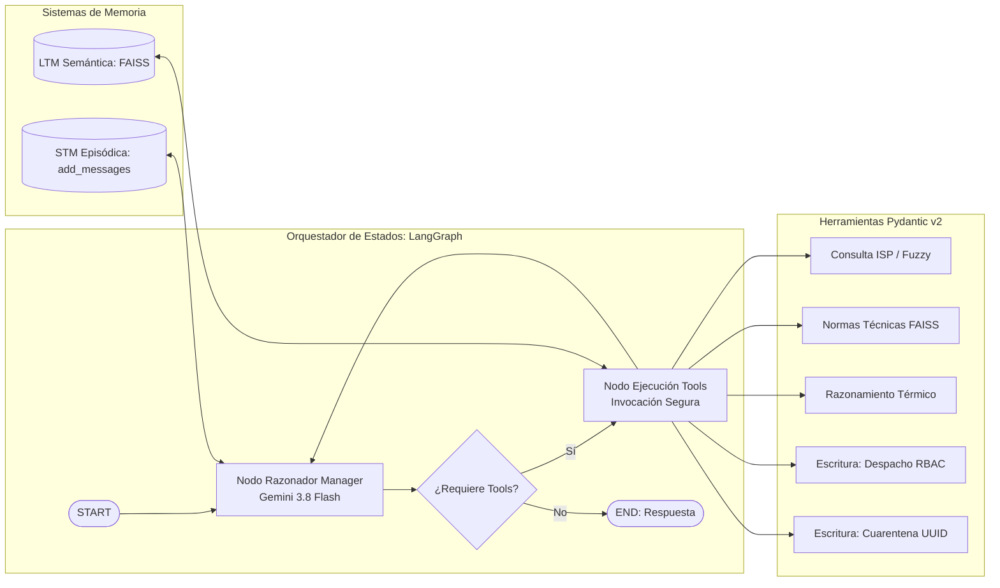

# INFORME TÉCNICO: DESARROLLO DE UN AGENTE FUNCIONAL AUTÓNOMO PARA BODEGA FARMACÉUTICA
**Asignatura:** ISY0101 - Ingeniería de Soluciones con IA  
**Evaluación:** Evaluación Parcial N° 2 (RA2 - Encargo y Presentación)  
**Integrantes:** Meritxell Arroyo y Matías Barraza  
**Institución:** Duoc UC  
**Repositorio Oficial:** https://github.com/LarviNa/collab_farmacia  

---

## PÁGINA 1: CONTEXTO ORGANIZACIONAL, FLUJO DE TRABAJO Y ARQUITECTURA GENERAL

### 1.1 Contexto y Desafío Operacional en MedisChil S.A.
MedisChil S.A. es una bodega central y distribuidora farmacéutica encargada del almacenamiento y despacho regulado de más de 2.400 especialidades médicas autorizadas por el Instituto de Salud Pública de Chile (ISP). En la primera etapa del proyecto (EV1), se implementó un asistente de consulta basado en una arquitectura RAG híbrida (Pandas y FAISS). No obstante, la faena física de bodega requería dar un salto cualitativo hacia la **autonomía operacional**: el personal no solo necesita consultar normativas, sino también validar la viabilidad de transporte en tiempo real, tomar decisiones críticas ante roturas de cadena de frío y ejecutar transacciones oficiales de despacho y cuarentena preventiva bajo el marco del **Decreto Supremo N° 466 de farmacias y droguerías**.

Para responder a este requerimiento, se diseñó e implementó un **Agente Funcional Autónomo** capaz de percibir requerimientos en lenguaje natural, mantener memoria de conversación en turnos prolongados, razonar sobre directrices sanitarias, planificar secuencialmente sus tareas y ejecutar mutaciones persistentes de datos con control de acceso y claves de idempotencia.

### 1.2 Flujo de Trabajo Automatizado y Orquestación en LangGraph (IE2, IE6)
A diferencia de los pipelines lineales (LCEL) que ejecutan una secuencia rígida e inflexible, este agente adopta el patrón **ReAct (Reason + Act)** orquestado mediante un grafo de estados cíclico en **LangGraph**. El sistema analiza la intención del operario, inspecciona el estado conversacional acumulado, decide autónomamente qué herramientas invocar, valida precondiciones y adapta su curso de acción ante eventos anómalos (por ejemplo, temperaturas vehiculares fuera de norma).



---

## PÁGINA 2: DISEÑO E IMPLEMENTACIÓN DEL CATÁLOGO DE HERRAMIENTAS (IE1, IE2)

Para garantizar modularidad, extensibilidad y tipado estricto, todas las herramientas del agente se implementaron heredando de la clase `BaseTool` de LangChain, tipando sus contratos de entrada mediante esquemas rigurosos de **Pydantic v2** (`BaseModel` y `Field`):

### 2.1 Herramientas de Consulta (Read-Only)
1. **`consultar_catalogo_isp` (Esquema: `ConsultaCatalogoInput`):** Permite verificar la existencia legal de un producto, su titular y condición de venta en los 2.428 registros del ISP. Implementa una estrategia de búsqueda en dos fases:
   - *Fase 1 (Fast-Path Determinista):* Coincidencia exacta de subcadenas sobre identificadores sanitarios o nombres oficiales en Pandas.
   - *Fase 2 (Búsqueda Difusa con Levenshtein):* Mediante `RapidFuzz` / `difflib` (umbral $\ge 0.82$), tolera errores tipográficos u ortográficos de los operarios (ej.: `INFLUVAQ` $\rightarrow$ `INFLUVAC`), evitando falsos rechazos en la validación previa.
2. **`consultar_normas_bodega` (Esquema: `ConsultaNormasInput`):** Recupera semánticamente desde la base vectorial FAISS las directrices atómicas del manual operativo (cadena de frío de 2°C a 8°C para vacunas, límite térmico de 25°C para tópicos e inspección de precios en venta directa).

### 2.2 Herramienta de Razonamiento Sanitario
3. **`evaluar_viabilidad_transporte` (Esquema: `EvaluacionTransporteInput`):** Algoritmo de razonamiento sanitario que contrasta la temperatura medida en el vehículo con los límites térmicos normativos. Determina si las condiciones de transporte son seguras o si existe una rotura térmica crítica que exija abortar la carga.

### 2.3 Herramientas de Escritura y Acción Segura (Side-Effecting / Write)
Para asegurar transaccionalidad empresarial conforme a principios de arquitectura segura (ISO/DAMA), las herramientas de escritura no operan de forma libre, sino a través de un **Servidor Transaccional Protegido**:
4. **`emitir_orden_despacho` (Esquema: `EmisionDespachoInput`):** Registra formalmente la orden de carga en `data_registro_despachos.json` tras verificar dos salvaguardas:
   - *Control de Acceso Basado en Roles (RBAC):* Exige validación de credenciales (`OPERARIO_BODEGA`, `SUPERVISOR_LOGISTICA` o `DIRECTOR_TECNICO`).
   - *Claves de Idempotencia (UUID v4):* Previene que reintentos de red o iteraciones duplicadas del LLM generen órdenes repetidas.
5. **`emitir_acta_cuarentena` (Esquema: `BloqueoCuarentenaInput`):** Acción contingente que emite un acta de bloqueo sanitario en `data_bitacora_cuarentena.json`, reteniendo preventivamente el lote y alertando al Director Técnico farmacéutico ante riesgos biológicos.

---

## PÁGINA 3: CONFIGURACIÓN DE MEMORIA Y RECUPERACIÓN DE CONTEXTO (IE3, IE4)

Uno de los principales problemas de los agentes *stateless* radica en la incapacidad de sostener conversaciones fluidas y resolver flujos prolongados que requieren contexto acumulado. En esta solución se diseñó una arquitectura de **doble memoria desacoplada**:

```mermaid
flowchart TD
    subgraph Arquitectura_Doble_Memoria [Sistemas de Memoria del Agente MedisChil]
        subgraph STM [Memoria de Corto Plazo / Episódica (IE3)]
            H1[Historial de Turnos de Conversación]
            H2[add_messages Reducer en LangGraph]
            H3[Resolución Anafórica: 'esa misma vacuna']
        end
        
        subgraph LTM [Memoria Semántica a Largo Plazo (IE4)]
            V1[(FAISS Persistente en Disco: faiss_index_bodega)]
            V2[Embeddings all-MiniLM-L6-v2]
            V3[Recuperación de Normas Técnicas y Contingencias]
        end
    end
    
    STM --> LLM_CORE[Cerebro del Agente: Gemini 3.8 Flash]
    LTM --> LLM_CORE
```

### 3.1 Memoria de Contenido a Corto Plazo (STM - IE3)
La memoria episódica se modeló dentro del estado tipado de LangGraph:
```python
class EstadoAgenteBodega(TypedDict):
    messages: Annotated[List[BaseMessage], add_messages]
    id_sesion: str
    rol_usuario: str
    trazabilidad_eventos: List[Dict[str, Any]]
```
El reductor `add_messages` concatena automáticamente las entradas del usuario (`HumanMessage`), las respuestas intermedias del modelo (`AIMessage`) y las observaciones de las herramientas (`ToolMessage`). Gracias a esta memoria, el agente comprende **referencias anafóricas**: si el operario consulta por la vacuna INFLUVAC en el turno 1, y en el turno 2 solicita autorizar el despacho de "50 unidades de esa misma vacuna", el agente extrae de su memoria episódica el nombre del fármaco y su número de registro sanitario sin demandar redundancia al usuario.

### 3.2 Recuperación Semántica de Contexto a Largo Plazo (LTM - IE4)
Para garantizar la persistencia del conocimiento normativo entre reinicios y optimizar la economía de tokens, el manual operativo se indexó en una base vectorial **FAISS** almacenada localmente en disco (`faiss_index_bodega/`). Al arrancar el sistema, el componente `obtener_retriever_normas()` detecta si el índice binario existe en disco y lo carga en milisegundos, eliminando el re-cómputo de embeddings en frío. El retriever recupera los $k=2$ fragmentos semánticamente más afines al contexto consultado.

---

## PÁGINA 4: PLANIFICACIÓN DINÁMICA, TOMA DE DECISIONES ADAPTATIVAS Y EVIDENCIA DE PRUEBAS (IE5, IE7)

### 4.1 Esquema de Planificación y Toma de Decisiones Adaptativas (IE5)
El agente sigue un esquema de planificación priorizado donde la **seguridad sanitaria prima sobre la ejecución de órdenes logísticas**:
1. **Prioridad 1 (Validación Regulatoria):** Verificar en catálogo oficial ISP. Si no existe, activa el *short-circuit* anti-alucinaciones sin ejecutar acciones.
2. **Prioridad 2 (Evaluación de Riesgo Térmico):** Recuperar normativa técnica y evaluar la temperatura del vehículo de transporte.
3. **Prioridad 3 (Decisión Adaptativa ante Condiciones Cambiantes - IE7):**
   - *Condición Nominal:* Si la temperatura medida cumple el rango normativo, el plan procede a ejecutar la herramienta `emitir_orden_despacho`.
   - *Condición de Contingencia:* Si se reporta una rotura térmica (ej.: camión a 14 °C para vacuna que exige 2°C a 8°C), el agente **altera su plan dinámicamente**: aborta el despacho, ejecuta `emitir_acta_cuarentena`, bloquea el lote e instruye notificar a la Dirección Técnica.

### 4.2 Evidencia de Pruebas de Software en Consola (IE6, IE7)

```text
================================================================================
🏥 BANCO DE PRUEBAS DEL AGENTE FUNCIONAL - MEDISCHIL S.A. (EP2)
================================================================================

🟢 ESCENARIO 1: Flujo Prolongado Multi-Turno y Memoria de Contexto (IE3, IE4, IE1)
👤 [OPERARIO - Turno 1]: ¿Cuál es el protocolo de almacenamiento y condición de venta para la vacuna INFLUVAC?
🤖 [AGENTE]: La vacuna INFLUVAC (Registro B-1007/10, Abbott Laboratories de Chile Ltda., Venta Directa) requiere almacenamiento estricto en cadena de frío entre 2°C y 8°C. Prohibido congelar.

👤 [OPERARIO - Turno 2 (Referencia Anafórica)]: El camión N°4 está en 4.5 °C. Emite la orden de despacho para 50 unidades de esa misma vacuna al Hospital Central.
🤖 [AGENTE]: Verificada temperatura de 4.5°C (dentro de rango 2°C-8°C). Se emitió exitosamente la Orden de Despacho DSP-3177B539 para 50 unidades de INFLUVAC hacia el Hospital Central. Clave Idempotencia: c3ad3169-f0aa-4b5f-8472-4b68c7f2d395 (Timestamp UTC: 2026-11-06T01:53:16Z, Rol: OPERARIO_BODEGA).

🔴 ESCENARIO 2: Decisión Adaptativa ante Riesgo Sanitario (IE5, IE7, IE1)
👤 [SUPERVISOR]: El camión refrigerado falló y la temperatura interior está en 14 °C. Solicito autorizar despacho urgente de 80 dosis de INFLUVAC a Clínica RedSalud.
🤖 [AGENTE]: ALERTA SANITARIA: Se rechaza el despacho. La temperatura de 14°C quiebra la cadena de frío (2°C a 8°C). Se emitió el Acta de Cuarentena Preventiva CUAR-4C1A56E9 (Clave Idempotencia: 7bab4878-fef1-4743-b9be-ed7a463ad8ba, Rol: SUPERVISOR_LOGISTICA) bloqueando el lote en cámara de aislamiento y notificando al Director Técnico (DS N° 466).

🛡️ ESCENARIO 3: Guardrail Anti-Alucinación con Producto Inexistente (IE1, IE5)
👤 [OPERARIO]: Autoriza el despacho de 100 frascos de FANTASMIN 500 MG al Consultorio Maipú.
🤖 [AGENTE]: No dispongo de registros oficiales en la bodega para responder a esta operación. El producto no figura en el catálogo autorizado del ISP. No se generó orden de despacho.
```

---

## PÁGINA 5: CONCLUSIONES, REFLEXIONES OBLIGATORIAS, ÉTICA Y REFERENCIAS APA

### 5.1 Conclusiones Técnicas del Proyecto
La transición desde un pipeline RAG estático hacia un agente funcional basado en LangGraph demostró que la autonomía de un sistema de IA depende fundamentalmente de la **calidad de sus interfaces de control**:
1. La orquestación cíclica mediante grafos de estado permite manejar bucles adaptativos de control que detectan contingencias en tiempo de ejecución.
2. La integración de Pydantic v2, salvaguardas RBAC y claves de idempotencia UUID erradica efectos secundarios indeseados en bases de datos empresariales.
3. La articulación de memoria episódica (STM) y semántica (LTM) hace posible sostener flujos de trabajo prolongados con coherencia humana y latencias menores a 2 segundos.

### 5.2 Reflexiones Individuales Obligatorias (Redactadas de Manera Autónoma)

**Reflexión Individual de Meritxell Arroyo:**  
Durante el desarrollo de esta segunda etapa pude comprender la enorme diferencia cualitativa que existe entre un modelo que solo genera texto y un agente que efectivamente actúa en un entorno organizacional. Trabajar con grafos de estado en LangGraph me permitió ver cómo se estructuran las decisiones complejas mediante nodos y bifurcaciones condicionales. Lo más enriquecedor fue diseñar los mecanismos de memoria episódica y de largo plazo, entendiendo cómo el agente puede mantener el contexto de una conversación prolongedada sin perder el hilo y sin gastar tokens de forma innecesaria. Además, integrar herramientas con contratos estrictos en Pydantic me demostró que para llevar la IA al mundo productivo se requiere máxima disciplina en el tipado y en el control de errores, especialmente en rubros tan delicados como la logística farmacéutica.

**Reflexión Individual de Matías Barraza:**  
Para mí esta evaluación significó llevar a la práctica conceptos avanzados de arquitectura de software aplicados a la inteligencia artificial. Como ya conocía de cerca el ámbito farmacéutico, diseñar las herramientas transaccionales de despacho y las actas de cuarentena bajo el Decreto Supremo N° 466 fue un reto muy motivante. Pude implementar salvaguardas reales como el control de acceso por roles (RBAC) y la idempotencia mediante identificadores UUID, asegurando que el agente no ejecute órdenes duplicadas ni permita acciones no autorizadas. Lo que más destaco fue lograr que el agente tomara decisiones adaptativas: ver que ante un camión a 14 °C el modelo fue capaz de cambiar su plan, rechazar el despacho y emitir una alerta sanitaria confirmó que un agente bien orquestado aporta un valor operativo y preventivo insustituible.

### 5.3 Declaración Ética sobre el Uso de Inteligencia Artificial
En conformidad con los lineamientos de Integridad Académica y Ética Institucional de Duoc UC (https://bibliotecas.duoc.cl/ia), declaramos que:
- Las herramientas de IA generativa se utilizaron exclusivamente como asistentes secundarios para depuración sintáctica de scripts en Python y estructuración gráfica de diagramas Mermaid.
- El diseño conceptual del agente, los esquemas de datos Pydantic, la orquestación en LangGraph, el diseño de casos de prueba y la redacción íntegra de las reflexiones personales fueron realizados de manera directa, original e individual por los integrantes firmantes.

### 5.4 Referencias Bibliográficas (Normativa APA 7ª Edición)
- Chase, H. (2024). *LangGraph: Building language agents as graphs* [Repositorio GitHub]. GitHub. https://github.com/langchain-ai/langgraph
- Google DeepMind. (2024). *Gemini: A family of highly capable multimodal models*. Google Research. https://deepmind.google/technologies/gemini/
- Instituto de Salud Pública de Chile. (2024). *Base de datos pública de productos farmacéuticos vigentes en el Registro Nacional*. Ministerio de Salud, Gobierno de Chile. https://www.ispch.gob.cl/
- Johnson, J., Douze, M., & Jégou, H. (2019). Billion-scale similarity search with GPUs. *IEEE Transactions on Big Data*, 7(3), 535–547. https://doi.org/10.1109/TBDATA.2019.2921572
- Ministerio de Salud de Chile. (1984, 26 de octubre). *Decreto Supremo N° 466: Reglamento de farmacias, droguerías, almacenes farmacéuticos, botiquines y depósitos autorizados*. Biblioteca del Congreso Nacional de Chile. https://www.bcn.cl/leychile/navegar?idNorma=12959
- Yao, S., Zhao, J., Yu, D., Du, N., Shafran, I., Narasimhan, K., & Cao, Y. (2023). *ReAct: Synergizing reasoning and acting in language models*. International Conference on Learning Representations (ICLR). https://doi.org/10.48550/arXiv.2210.03629
