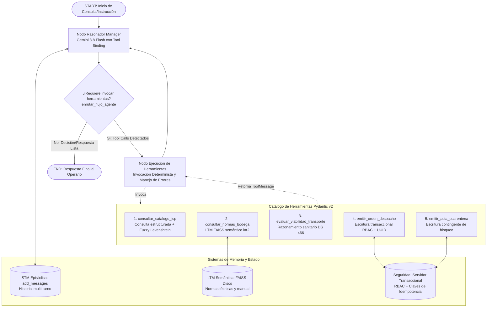
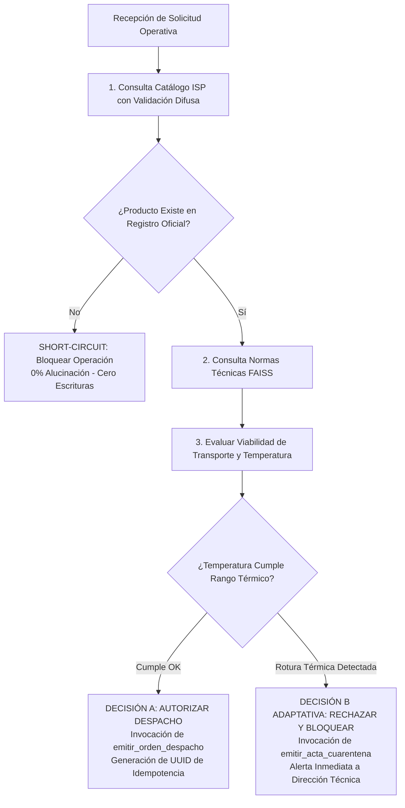

# Asistente Agéntico Inteligente de Logística y Seguridad Farmacéutica

> **Asignatura:** ISY0101 - Ingeniería de Soluciones con IA  
> **Institución:** Duoc UC  
> **Integrantes:** Meritxell Arroyo y Matías Barraza  
> **Organización:** MedisChil S.A. (Distribuidora y Bodega Farmacéutica)  
> **Caso de Estudio:** Orquestación Autónoma de Almacenamiento, Trazabilidad, Despacho y Seguridad Sanitaria (Registro ISP Chile y DS N° 466)  
> **Stack Tecnológico:** Python 3.11, LangGraph, LangChain, Google Gemini 3.8 Flash, Pydantic v2, FAISS, Pandas, RapidFuzz

---

## 1. Visión General del Proyecto

Este repositorio contiene la evolución completa del sistema inteligente para **MedisChil S.A.**:
1. **Evaluación Parcial N°1 (EV1 - RA1):** Pipeline RAG híbrido determinista/semántico en LCEL con validación previa de stock y guardrails anti-alucinaciones.
2. **Evaluación Parcial N°2 (EV2 - RA2):** **Agente Funcional Autónomo** construido con **LangGraph** (StateGraph cíclico ReAct), que integra herramientas de consulta estructurada y semántica, razonamiento sanitario, transacciones seguras de escritura (RBAC + Idempotencia UUID v4), doble memoria (STM episódica y LTM vectorial persistente), y toma de decisiones adaptativas ante contingencias térmicas.

---

## 2. Arquitectura de Orquestación del Agente (LangGraph - EP2)

El agente implementa un ciclo de percepción, razonamiento, decisión y acción mediante un **Grafo de Estados Cíclico** (`StateGraph`):



---

## 3. Catálogo de Herramientas Implementadas (IE1)

Todas las herramientas heredan de `BaseTool` de LangChain y utilizan contratos estrictos con esquemas de `Pydantic v2` (`BaseModel` y `Field`):

| Nombre de Herramienta | Tipo | Esquema Pydantic (`args_schema`) | Descripción Funcional y Reglas Sanitarias |
| :--- | :---: | :--- | :--- |
| `consultar_catalogo_isp` | **Consulta** | `ConsultaCatalogoInput` (`termino_busqueda: str`) | Búsqueda en dos niveles: 1) coincidencia exacta por registro sanitario o nombre, y 2) coincidencia difusa (distancia de Levenshtein $\ge 0.82$). Consulta los 2.428 medicamentos vigentes del ISP. |
| `consultar_normas_bodega` | **Consulta** | `ConsultaNormasInput` (`tipo_o_categoria_medicamento: str`) | Recuperación semántica desde la base vectorial FAISS con persistencia en disco de las directrices de almacenamiento y despacho. |
| `evaluar_viabilidad_transporte` | **Razonamiento** | `EvaluacionTransporteInput` (`nombre_producto`, `temperatura_camion_c`, `tipo_producto`) | Motor de reglas sanitarias que evalúa si la temperatura del vehículo respeta el rango exigido (Vacunas: 2°C a 8°C; Tópicos: $\le 25^\circ\text{C}$). Detecta roturas térmicas. |
| `emitir_orden_despacho` | **Escritura Segura** | `EmisionDespachoInput` (`token_rol`, `nombre_producto`, `n_registro`, `cantidad`, `destino`, `temperatura_transporte`, `clave_idempotencia`) | Emite orden oficial en `data_registro_despachos.json` validando privilegios RBAC (`OPERARIO_BODEGA`, `SUPERVISOR_LOGISTICA`, `DIRECTOR_TECNICO`) y unicidad por UUID v4. |
| `emitir_acta_cuarentena` | **Escritura Segura** | `BloqueoCuarentenaInput` (`token_rol`, `nombre_producto`, `n_registro`, `motivo_incumplimiento`, `temperatura_detectada`, `clave_idempotencia`) | Emite acta sanitaria oficial en `data_bitacora_cuarentena.json`, reteniendo preventivamente el lote y alertando al Director Técnico farmacéutico (Decreto Supremo N° 466). |

---

## 4. Arquitectura de Memoria y Continuidad de Contexto (IE3, IE4)

El agente supera las limitaciones de los sistemas *stateless* implementando una arquitectura de doble memoria:

### 4.1 Memoria de Corto Plazo Episódica (STM - IE3)
- **Implementación:** Variable `messages: Annotated[List[BaseMessage], add_messages]` dentro del TypedDict `EstadoAgenteBodega` de LangGraph.
- **Capacidad:** Mantiene la coherencia contextual en diálogos prolongados, permitiendo referencias anafóricas (ej.: el operario pregunta por *"INFLUVAC"* en el Turno 1 y luego en el Turno 2 dice *"emite un despacho de 50 dosis de esa misma vacuna"* sin repetir el nombre del producto).

### 4.2 Memoria Semántica a Largo Plazo (LTM - IE4)
- **Implementación:** Almacén vectorial FAISS con persistencia local en disco (`faiss_index_bodega/`) indexado con embeddings locales de alta velocidad (`all-MiniLM-L6-v2`).
- **Capacidad:** Permite al agente consultar y recuperar semánticamente las directrices del manual técnico de bodega incluso tras reinicios del sistema, optimizando la latencia operacional a menos de 50 ms.

---

## 5. Planificación y Toma de Decisiones Adaptativas (IE5, IE7)

El agente no ejecuta un pipeline estático lineal, sino que **planifica dinámicamente según las condiciones observadas del entorno**:



### Casos de Decisión Adaptativa Demostrables:
1. **Flujo de Despacho Exitoso:** Vacuna INFLUVAC en furgón a 4.5 °C $\rightarrow$ Cumple rango 2°C a 8°C $\rightarrow$ Emite orden autorizada de carga.
2. **Contingencia Sanitaria (Adaptación en Caliente):** Vacuna INFLUVAC en furgón a 14 °C $\rightarrow$ Detecta rotura de cadena de frío $\rightarrow$ El agente **cambia de plan autónomamente**, rechaza el despacho y emite el acta oficial de cuarentena preventiva.
3. **Guardrail Anti-Alucinaciones:** Intento de despacho de fármaco ficticio (`FANTASMIN 500`) $\rightarrow$ Detección inmediata de no-registro $\rightarrow$ Corta el flujo protegiendo la base de datos contra escrituras erróneas.

---

## 6. Justificación Técnica de Componentes y Frameworks (IE2, IE9)

- **LangGraph sobre LangChain Agents tradicional:** LangGraph proporciona grafos de estado cíclicos con transiciones deterministas, control explícito de puntos de decisión y compatibilidad nativa con memorias basadas en `add_messages`, garantizando escalabilidad y depuración auditable.
- **Google Gemini 3.8 Flash:** Modelo de última generación con latencia reducida (< 1.5 s), soporte nativo de Function Calling estricto y costo de inferencia nulo o altamente eficiente para flujos organizacionales masivos.
- **Pydantic v2 (`BaseModel`, `Field`):** Garantiza validación de tipos y rangos en tiempo de ejecución (`gt=0`, rangos de temperatura), impidiendo inyecciones de datos anómalos a las herramientas de escritura.
- **FAISS con Persistencia Local:** Resuelve la latencia de red eliminando la dependencia de servicios vectoriales cloud para normativas de tamaño controlado, manteniendo el desacoplamiento para futuras migraciones a Qdrant o Pgvector.
- **RBAC + Claves de Idempotencia (UUID v4):** Cumple con los estándares de seguridad transaccional empresarial (ISO/DAMA), previniendo dobles despachos ante reintentos de red.

---

## 7. Instrucciones de Instalación y Ejecución

### Prerrequisitos
- Python 3.10 o 3.11.
- Clave de API de Google Gemini (`GOOGLE_API_KEY`), configurable en archivo `.env`.

### Paso 1: Clonar el Repositorio
```bash
git clone https://github.com/LarviNa/collab_farmacia.git
cd collab_farmacia
```

### Paso 2: Crear y Activar Entorno Virtual
En Windows (PowerShell):
```powershell
python -m venv .venv
.\.venv\Scripts\Activate.ps1
```

En Linux / macOS:
```bash
python3 -m venv .venv
source .venv/bin/activate
```

### Paso 3: Instalar Dependencias
```bash
pip install -r Requisitos.txt
```

### Paso 4: Configurar Variables de Entorno
Copia `.env.example` a `.env` y define tu clave de Google Gemini:
```env
GOOGLE_API_KEY=tu_clave_de_gemini_aqui
```

### Paso 5: Ejecución de Componentes

1. **Ejecutar Batería de Pruebas del Agente Funcional (EP2):**
   ```bash
   python test_agente_ep2.py
   ```
2. **Ejecutar Pipeline RAG de la Entrega 1 (EV1 con Fuzzy Matching):**
   ```bash
   python Solucion.py
   ```
3. **Ejecutar Evaluación Cuantitativa de Métricas RAG (Ragas Style):**
   ```bash
   python evaluacion_rag.py
   ```

---

## 8. Estructura del Repositorio

```text
collab_farmacia/
├── agente_medischil.py              # Agente Funcional oficial EP2 (LangGraph + Tools + Memoria)
├── test_agente_ep2.py               # Suite de pruebas automatizadas de toma de decisiones adaptativas
├── Solucion.py                      # Pipeline RAG híbrido EV1 (con Fuzzy Matching y FAISS persistente)
├── evaluacion_rag.py                # Suite de evaluación cuantitativa RAG (Faithfulness / Relevance)
├── Productos_farmaceuticos_...csv   # Catálogo oficial ISP de 2.428 registros
├── data_registro_despachos.json     # Persistencia de órdenes de despacho (Escritura segura)
├── data_bitacora_cuarentena.json    # Persistencia de actas de bloqueo sanitario (Cuarentena)
├── auditoria_operacional.log        # Registro de trazabilidad auditable (RotatingFileHandler)
├── Requisitos.txt                   # Dependencias oficiales del proyecto
├── README.md                        # Documentación técnica completa y diagramas de arquitectura
├── EA1.md                           # Documentación de la Fase 1 (RA1)
└── INFORME_TECNICO_EP2.md           # Borrador estructurado del Informe Técnico de 5 páginas
```

---

## 9. Declaración Ética y Normativa APA (IE6, IE9)

- **Uso Ético de IA:** Se utilizaron modelos de IA exclusivamente como apoyo para la optimización de código y diagramas arquitectónicos. Todas las decisiones de diseño de software, esquemas Pydantic, lógica de orquestación y reflexiones personales son de autoría directa de los estudiantes.
- **Referencias Bibliográficas (APA 7ma Edición):**
  - Chase, H. (2024). *LangGraph: Building language agents as graphs*. LangChain AI. https://github.com/langchain-ai/langgraph
  - Google DeepMind. (2024). *Gemini: A family of highly capable multimodal models*. Google Research. https://deepmind.google/technologies/gemini/
  - Instituto de Salud Pública de Chile. (2024). *Registro Nacional de Productos Farmacéuticos vigentes en Chile*. Ministerio de Salud, Gobierno de Chile. https://www.ispch.gob.cl/
  - Ministerio de Salud de Chile. (1984). *Decreto Supremo N° 466: Reglamento de farmacias, droguerías, almacenes farmacéuticos y botiquines*. Biblioteca del Congreso Nacional de Chile. https://www.bcn.cl/leychile/navegar?idNorma=12959
  - Yao, S., Zhao, J., Yu, D., Du, N., Shafran, I., Narasimhan, K., & Cao, Y. (2023). *ReAct: Synergizing reasoning and acting in language models*. International Conference on Learning Representations (ICLR). https://doi.org/10.48550/arXiv.2210.03629
