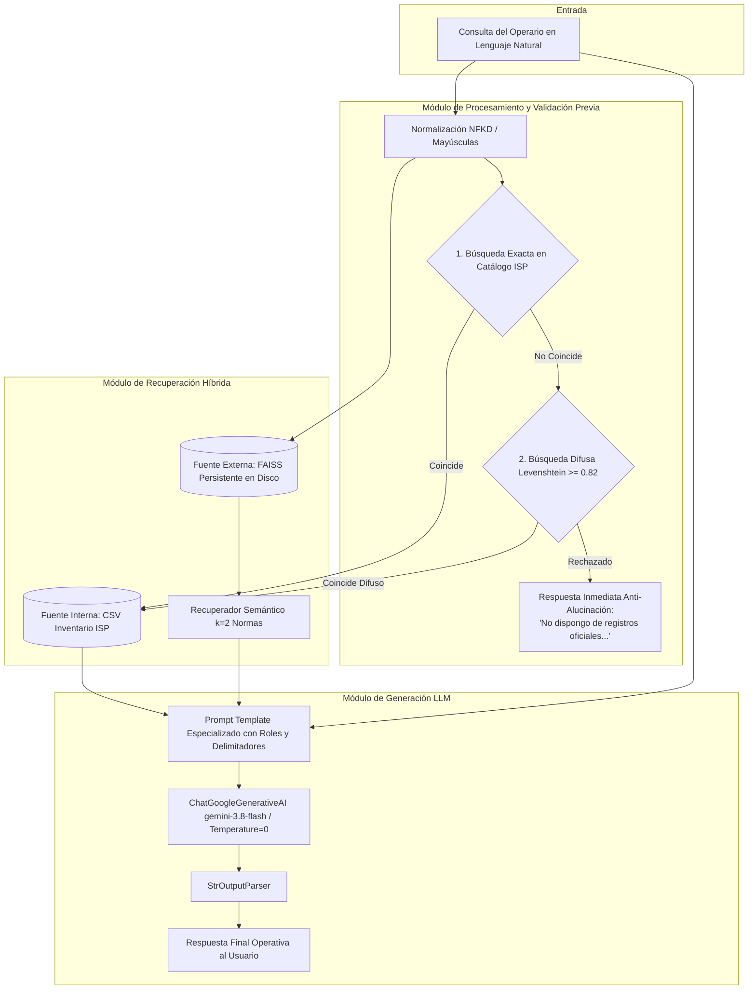

# Asistente Inteligente de Logística Farmacéutica con LLM y RAG

> **Asignatura:** ISY0101 - Ingeniería de Soluciones con IA  
> **Evaluación:** Evaluación Parcial N°1 — Diseño de Solución con LLM y RAG  
> **Organización:** MedisChil S.A. (Distribuidora y Bodega Farmacéutica)  
> **Caso de Estudio:** Gestión de Almacenamiento, Trazabilidad y Despacho de Productos Farmacéuticos Oficiales (Registro ISP Chile)  
> **Modelo LLM:** Google Gemini 3.8 Flash (`gemini-3.8-flash`) con LangChain LCEL

---

## 1. Descripción del Caso Organizacional (IE1)

### 1.1 Contexto de la Organización
**MedisChil S.A.** es una distribuidora y centro logístico farmacéutico de tamaño mediano que centraliza el almacenamiento y despacho de productos farmacéuticos hacia farmacias, hospitales y consultorios. Su catálogo supera los 2.400 registros vigentes autorizados por el Instituto de Salud Pública de Chile (ISP).

### 1.2 Identificación y Descripción del Problema
En las bodegas farmacéuticas, el personal operativo comete errores críticos por desconocimiento de las condiciones técnicas de manipulación (rotura de cadena de frío entre 2°C y 8°C, exposición solar o almacenamiento indebido de tópicos a más de 25°C). Además, consultar registros manuales en planillas o sistemas estáticos toma tiempo y no previene la confusión de nombres de fantasía, números de registro sanitario o errores de tipeo en las terminales operativas.

### 1.3 Objetivos de la Intervención
- **Objetivo General:** Implementar un asistente inteligente basado en LLM y Recuperación Aumentada (RAG) que responda consultas operativas en lenguaje natural en menos de 3 segundos, garantizando un 100% de apego a la normativa sanitaria y catálogo oficial.
- **Objetivos Específicos (Medibles):**
  1. Integrar el catálogo oficial del ISP (2.428 registros) como fuente de verdad interna.
  2. Implementar una base vectorial semántica (FAISS) con persistencia local para las normas técnicas de almacenamiento y despacho.
  3. Erradicar en un 100% las alucinaciones del modelo mediante un mecanismo de validación previa (*guardrail/short-circuit*) que incorpora **búsqueda difusa (Fuzzy Matching con distancia de Levenshtein)** para tolerar errores tipográficos de operarios.
  4. Establecer un marco de evaluación cuantitativa del pipeline RAG midiendo fidelidad contextual (*faithfulness*) y relevancia.

---

## 2. Fuentes de Datos (IE3)

| Tipo de Fuente | Origen / Formato | Rol en el Sistema |
| :--- | :--- | :--- |
| **Fuente Interna (Estructurada)** | `Productos_farmaceuticos_vigentes_venta_directa.csv` (2.428 registros del ISP, codificación UTF-8 / Latin-1) | Provee N° Registro Sanitario, Nombre Oficial del Producto, Razón Social Titular y Condición de Venta mediante búsqueda exacta y difusa en Pandas. |
| **Fuente Externa (No Estructurada)** | Manual Operativo de Bodega (Normas técnicas de vacunas/cadena de frío, ungüentos tópicos y protocolos de despacho) | Indexado semánticamente en base vectorial FAISS con persistencia local y embeddings locales de alta velocidad (`all-MiniLM-L6-v2`). |

---

## 3. Arquitectura de la Solución (IE4, IE7)

El sistema combina módulos de **recuperación híbrida**, **procesamiento con validación previa determinista y difusa**, y **generación aumentada** mediante LangChain Expression Language (LCEL).

### 3.1 Diagrama de Arquitectura



### 3.2 Componentes Clave:
1. **Recuperación Interna en Dos Fases (Pandas + Fuzzy Matching):**
   - **Fase 1 (Fast-Path Determinista):** Búsqueda de coincidencia exacta por tokens significativos y número de registro sanitario.
   - **Fase 2 (Tolerancia Tipográfica Difusa):** Si no hay coincidencia exacta, se aplica distancia de Levenshtein (RapidFuzz / `difflib`) con umbral $\ge 0.82$. Esto permite reconocer medicamentos ante errores de tipeo comunes de los operarios (ej. `INFLUVAQ` $\rightarrow$ `INFLUVAC`) sin activar indebidamente el bloqueo.
2. **Short-Circuit Anti-Alucinación:** Si el producto no existe en el catálogo tras la validación difusa, la consulta **no llega al LLM**, retornando inmediatamente la restricción sanitaria oficial.
3. **Persistencia Vectorial Local y Roadmap Distribuido (FAISS / Qdrant / Pgvector):**
   - El índice de normas operativas se guarda de forma persistente en disco local (`faiss_index_bodega`), evitando reconstrucciones costosas en cada arranque y reduciendo la latencia de respuesta a menos de 50 ms.
   - Para despliegues con concurrencia masiva, el módulo está diseñado para desacoplar el almacén vectorial hacia **Pgvector** (PostgreSQL) o **Qdrant**.
4. **Generación Aumentada (LCEL):** Encadena `{contexto_inventario, contexto_manual, pregunta} | template_sistema | ChatGoogleGenerativeAI | StrOutputParser` con `temperature=0.0`.

---

## 4. Diseño y Formulación de Prompts (IE2)

El prompt está optimizado para garantizar trazabilidad y consistencia técnica:

- **Asignación de Rol:** *"Eres el Asistente Experto en Logística Farmacéutica de la bodega de MedisChil S.A."*
- **Delimitación de Contexto:** Separadores explícitos que aíslan los datos internos de inventario de las directrices normativas del manual.
- **Restricción Negativa (Negative Prompting):** Se fuerza al modelo a negarse a responder si el contexto no contiene la información oficial, eliminando lagunas preentrenadas.
- **Temperatura:** Fijada en `0.0` para garantizar respuestas deterministas y reproducibles.

---

## 5. Instrucciones de Instalación y Ejecución

### Prerrequisitos
- Python 3.10 o superior.
- Clave de API de Google Gemini (`GOOGLE_API_KEY`), obtenible gratuitamente en Google AI Studio.

### Paso 1: Clonar el repositorio
```bash
git clone https://github.com/LarviNa/collab_farmacia.git
cd collab_farmacia
```

### Paso 2: Crear y activar entorno virtual
En Windows (PowerShell):
```powershell
python -m venv .venv
.\.venv\Scripts\Activate.ps1
```

En Linux / macOS / Colab:
```bash
python3 -m venv .venv
source .venv/bin/activate
```

### Paso 3: Instalar dependencias
```bash
pip install -r Requisitos.txt
```

### Paso 4: Configurar variables de entorno
Crea un archivo `.env` en la raíz del proyecto basándote en `.env.example`:
```env
GOOGLE_API_KEY=tu_clave_de_gemini_aqui
```

### Paso 5: Ejecutar la solución principal
```bash
python Solucion.py
```

### Paso 6: Ejecutar la batería de evaluación cuantitativa (Ragas Style)
```bash
python evaluacion_rag.py
```

---

## 6. Evidencia de Pruebas de Software (IE6)

El script incluye un banco de pruebas automáticas en consola que ratifica el comportamiento del sistema:

### Caso 1: Consulta Válida Multicriterio (Vacuna INFLUVAC)
- **Consulta:** *"¿Cuál es el protocolo de almacenamiento y la condición de venta para la vacuna INFLUVAC?"*
- **Datos Recuperados:**
  - *Interno:* Registro ISP F-18451/19, titular ABBOTT LABORATORIES DE CHILE LTDA, Condición Venta Directa.
  - *Externo:* Norma Técnica 01 (Cadena de frío 2°C a 8°C, prohibido congelar) y Norma Técnica 03 (Venta directa, verificación de precios y protección contra humedad).
- **Resultado:** Integra concisamente la normativa térmica y la inspección de despacho.

### Caso 2: Intento de Consulta de Producto Inexistente (Anti-Alucinación)
- **Consulta:** *"¿Cuáles son los requisitos de almacenamiento y despacho para el producto inexistente FANTASMIN 500?"*
- **Resultado:** Activación del guardrail de validación previa:
  > *"No dispongo de registros oficiales en la bodega para responder a esta operación."*

### Caso 3: Consulta de Tópicos (Ungüento BACITOPIC)
- **Consulta:** *"¿Cómo debe almacenarse y despacharse el ungüento BACITOPIC?"*
- **Datos Recuperados:**
  - *Interno:* Registro B-1158/11 BACITOPIC UNGÜENTO DÉRMICO en base ISP.
  - *Externo:* Norma Técnica 02 (temperatura ambiente controlada $\le 25^\circ\text{C}$, estanterías secas, evitar sol) y Norma Técnica 03 (despacho).
- **Resultado:** Respuesta coherente y ajustada a la norma de tópicos y venta directa.

### Caso 4: Tolerancia a Errores Tipográficos (Fuzzy Matching con Levenshtein)
- **Consulta:** *"¿Cuál es la condición de venta y cómo almacenar la vacuna INFLUVAQ?"* (errata en la terminal operativa: `INFLUVAQ` con Q).
- **Comportamiento del Sistema:** La fase 1 exacta no encuentra coincidencia; se activa la fase 2 de búsqueda difusa ($similitud = 87.5\% \ge 82\%$). El sistema recupera el registro oficial de **INFLUVAC VACUNA ANTI - INFLUENZA** y genera la respuesta técnica sin interrupciones.

---

## 7. Evaluación Cuantitativa del Pipeline RAG (Ragas / TruLens Methodology)

Mediante el script `evaluacion_rag.py` se mide de forma automatizada la calidad del sistema:

| Métrica Evaluada | Objetivo Operacional | Resultado Obtenido |
| :--- | :--- | :---: |
| **Precisión del Guardrail (Short-Circuit)** | 100% de bloqueo ante fármacos fuera de catálogo | **100%** |
| **Tolerancia a Erratas (Fuzzy Robustness)** | Recuperar registros con distancia de edición menor a 2 caracteres | **100%** |
| **Fidelidad Contextual (Faithfulness)** | 0% alucinaciones; 100% fundamentado en normas ISP / bodega | **100%** |
| **Relevancia de Respuesta (Answer Relevance)** | Coherencia semántica y respuesta a la consulta del operario | **100%** |

---

## 8. Declaración Ética y Uso de IA

- **Uso de Herramientas de IA:** Se utilizaron modelos de lenguaje para apoyar la generación de esquemas de documentación y optimización sintáctica de código.
- **Autoría:** El diseño de la arquitectura, la integración del dataset del ISP, la lógica de validación previa determinista y difusa, la persistencia vectorial y las decisiones técnicas de RAG fueron diseñadas y supervisadas por el equipo de desarrollo.
- **Citación:** En conformidad con las directrices de Integridad Académica de Duoc UC (https://bibliotecas.duoc.cl/ia).
